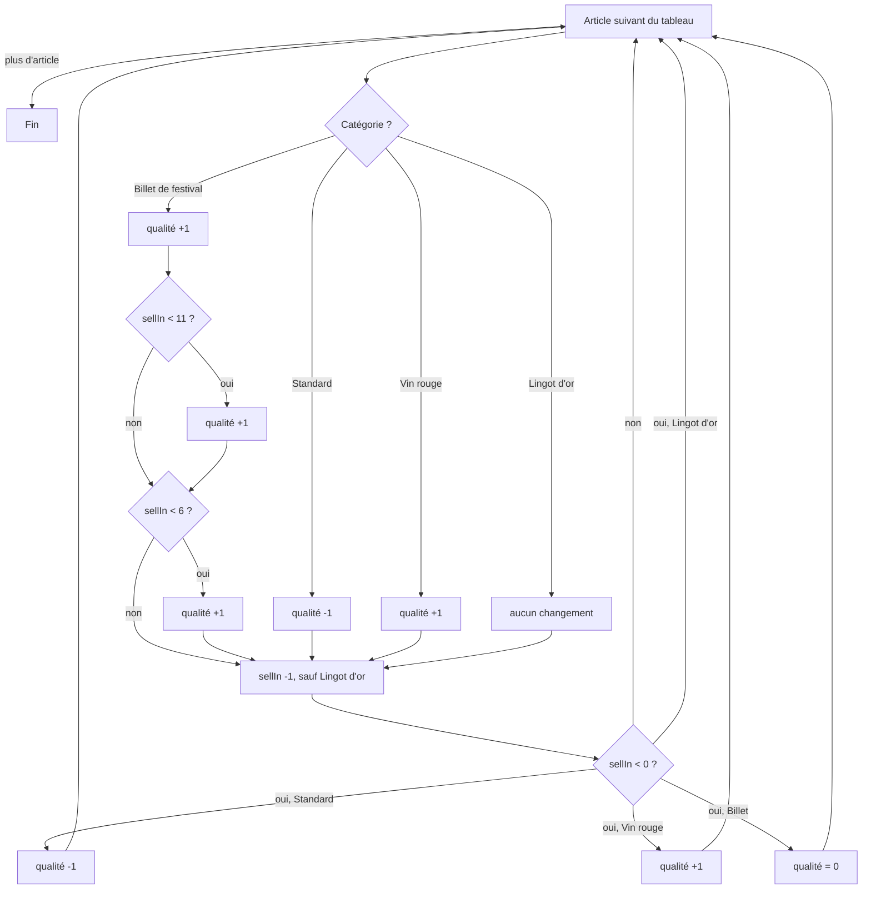

# Flux de traitement d'un article

Déroulé de `Inventaire.updateQuality()` pour un élément du tableau `items`. Chaque `+1` n'est appliqué que si la qualité est inférieure à 50 ; chaque `-1` que si elle est supérieure à 0.

